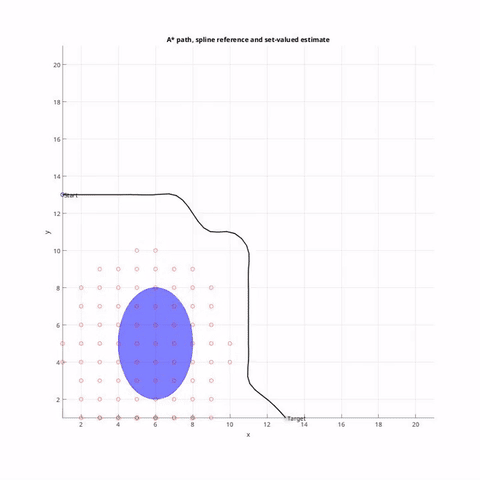
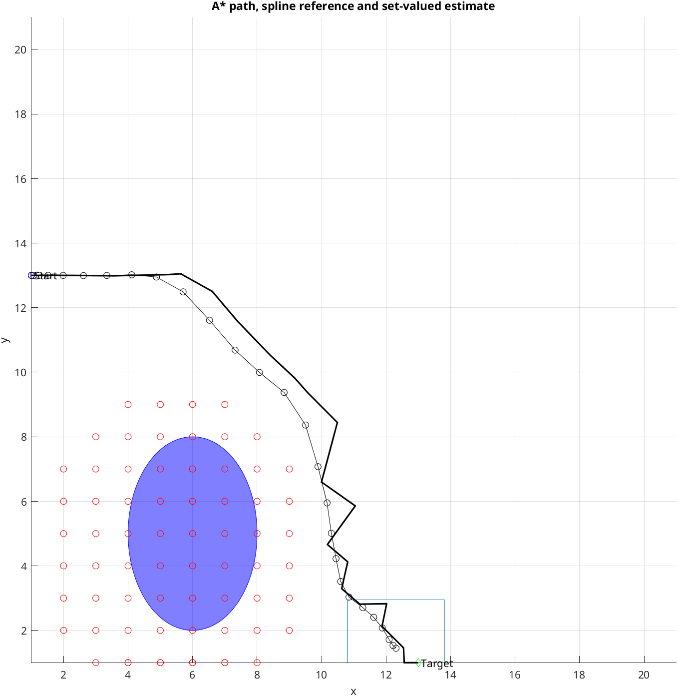

# A ground vehicle that avoids obstacles and detects its own faults

Decision Systems (SDC), final project, 2024/2025 · MATLAB · A*, Kalman filter, set-valued observers.

## What

A decision system for a ground vehicle, built in three iterations: a double-integrator model with
an A* path smoothed by splines, a controller and a fault-detection observer; then the nonlinear
vehicle model handled by feedback linearisation; then an optimised version of the whole chain.

## How

The map is a 20 × 20 grid. At every step A* plans a path to the target around an obstacle whose
keep-out zone grows with how unsure the vehicle is of its own position; cubic splines turn the
grid path into a smooth reference, which a pole-placement controller follows. A Kalman filter
estimates the state, and a set-valued observer built on constrained zonotopes bounds every
position the vehicle could be in: if that set collapses, the measurements no longer fit the model
and a fault is reported.

## Results

<table>
  <tr>
    <td width="50%"></td>
    <td width="50%"></td>
  </tr>
  <tr>
    <td>Simulation: the path is re-planned at every step around the obstacle, which grows with the
      uncertainty of the position estimate. (<a href="media/astar.mp4">MP4</a>)</td>
    <td>The finished run: blocked grid cells (red), the vehicle positions (circles) and the last
      set-valued estimate (box).</td>
  </tr>
</table>

Re-run in MATLAB R2024a, with the start and target fixed instead of picked with the mouse.

## Contents

| Path | Content |
|---|---|
| `SDEC_Project.pdf` | The assignment |
| `Report/` | Report (`main.pdf`) and its LaTeX source |
| `main_v1.m` | Iteration 1: double integrator, A* + splines, controller, Kalman filter and set-valued observer |
| `main_v2.m` | Iteration 2: nonlinear vehicle model with feedback linearisation |
| `main_v3.m` | Iteration 3: optimised version of the whole chain |
| `ground_vehicle.m` | Nonlinear vehicle dynamics |
| `computeSplineCoefficients.m` | Cubic-spline coefficients for the reference |
| `integer_points_in_circle.m` | Grid cells inside the obstacle's keep-out zone |
| `Astar/` | A* search, from the MathWorks File Exchange demo (copyright notices kept in each file) |
| `media/` | Video and figure above |

## Running

The scripts need two toolboxes next to them, which are not included here:

- [YALMIP](https://github.com/yalmip/YALMIP), in `YALMIP-develop/`
- ReachTool (constrained zonotopes, provided in the course), in `ReachTool-main/`

Then run `main_v3` (or `main_v1`, `main_v2`) from the repository root. The start and target are
picked with the mouse on the map.

## License

My own code is GPL-3.0, see [LICENSE](LICENSE). The files in `Astar/` keep their original
MathWorks copyright.
